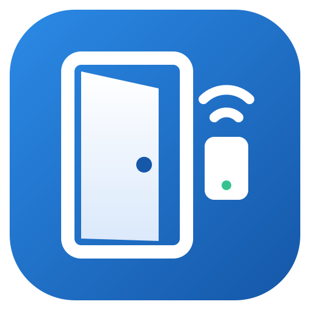

<p align="center"></p>

# UHPPOTE Desk

Web application (Node.js + React) to manage **UHPPOTE UT0311-L0x** access controllers (in particular the 4-door UT0311-L04), replacing the Windows "Access Control" software (N3000).

## Acknowledgements

This project would not exist without **[uhppoted](https://codeberg.org/uhppoted)**, the open-source project that reverse-engineered and documented the UHPPOTE controller protocol and built a complete set of tools around it. Many thanks to its author and contributors for their work and for publishing it under the MIT licence.

What UHPPOTE Desk owes to uhppoted:

| uhppoted component | How it was used here |
|---|---|
| [uhppoted-core](https://codeberg.org/uhppoted/uhppoted-core) | Reference implementation and the main source of knowledge about the protocol: packet layout, encodings, the 34 commands, event and reason codes, firmware quirks |
| [uhppoted-codegen](https://codeberg.org/uhppoted/uhppoted-codegen) | The protocol model (`models.json`) behind our codec, and the official **test vectors** included in [packages/protocol/test/fixtures](packages/protocol/test/fixtures) (MIT, see [NOTICE](packages/protocol/test/fixtures/NOTICE.md)) |
| [uhppoted-lib-nodejs](https://codeberg.org/uhppoted/uhppoted-lib-nodejs) (npm `uhppoted`) | Studied while designing our TypeScript implementation, and used in the differential tests as an independent reference |
| [uhppoted-simulator](https://codeberg.org/uhppoted/uhppoted-simulator) | Integration tests against an independent controller implementation before the hardware was available |
| [uhppoted-cli](https://codeberg.org/uhppoted/uhppoted-cli) | Cross-check of packets during hardware commissioning (`npm run hw -- --cli …`) |
| [node-red-contrib-uhppoted](https://flows.nodered.org/node/node-red-contrib-uhppoted) / [uhppoted-lib-node-red](https://codeberg.org/uhppoted/uhppoted-lib-node-red) | The starting point that showed the protocol can be driven from Node.js |

UHPPOTE Desk is an independent project and is not affiliated with uhppoted or with the controller manufacturer. It also builds on many other open-source projects, including Node.js, Fastify, React, Mantine, TanStack Query, i18next, zod, Vite, Vitest and Playwright.

## Features

Controller discovery and configuration, people/cards/permissions with automatic synchronisation, time profiles, scheduled tasks, interlock, anti-passback, keypads and door passcodes, first card, remote door opening, live monitor with photos, event history, attendance (shifts, holidays, leave, manual punches, reports), operators with roles and an audit log.

The user interface is available in **English** (base language), **Italian**, **Spanish**, **French** and **German** — see [Languages](#languages).

**User manual** (PDF, with screenshots of every page): [docs/UHPPOTE-Desk-Manual.pdf](docs/UHPPOTE-Desk-Manual.pdf). It is generated from [docs/manual](docs/manual) with `npm run manual`.

The full technical analysis (protocol, design decisions, risks) is in [ANALYSIS.md](ANALYSIS.md).

## Repository layout

| Path | Content |
|---|---|
| [packages/protocol](packages/protocol) | TypeScript codec for the 34 commands, UDP/TCP transport, client with a per-controller queue, event listener, **FakeController** (emulator for tests) |
| [packages/shared](packages/shared) | zod API schemas, DTOs, translations (`src/i18n`) |
| [apps/server](apps/server) | Fastify backend: SQLite (`node:sqlite`), authentication and roles, synchronisation, event collection, monitoring, attendance, WebSocket |
| [apps/web](apps/web) | React + Mantine frontend |
| [tools/hwtest](tools/hwtest) | Test suite for the real controller (levels L0–L5) and a development simulator |
| [e2e](e2e) | Playwright end-to-end tests |
| [docker](docker) | Docker image, compose files, Unraid template |
| [docs](docs) | Installation guides |

## Requirements

- Node.js ≥ 22 (developed with Node 24)
- For deployment: Docker with `network_mode: host` support (Linux/NAS)

## Development

```bash
npm install
cp .env.example .env            # local configuration
npm run sim                     # terminal 1: simulated controller on 0.0.0.0:60000 (keyboard commands: s <card> <door>, o/c <door>, b <door>…)
npm run dev                     # terminal 2: server (http://localhost:8080) + web with hot reload (http://localhost:5173)
```

The user `admin` gets the password from `ADMIN_PASSWORD` (applied at every start); if the variable is not set, a password is generated on the first start, printed in the log and must be changed at first login. Under *Controllers → Search network* the simulator is found just like a real controller.

## Tests

| Command | What it checks |
|---|---|
| `npm test` | Unit: codec against the **official uhppoted vectors** (35 messages), differential tests against the npm `uhppoted` library, BCD/Wiegand encodings, attendance engine, sync, CSV |
| `npm run test:int` | Integration on real sockets: client ↔ FakeController (UDP/TCP, listener, timeouts, retries), end-to-end server (API → UDP → events → DB → WebSocket), hardware suite against the simulator |
| `UHPPOTED_SIM=127.0.0.1 npm run test:int` | Additionally: tests against the **official uhppoted simulator** (an independent Go implementation). Start it first: `docker compose -f docker/docker-compose.test.yml up -d` or, on Windows, `uhppote-simulator.exe --devices <dir>` (release v0.9.0 on codeberg.org/uhppoted/uhppoted-simulator) |
| `npm run e2e` | Playwright: login and password change, discovery and adding a controller, person + card + permission → card on the controller, live monitor, every page without errors, language switching, roles |
| `npm run typecheck` | Type checking of all packages |

The same checks (typecheck, unit and integration tests) run on every push in GitHub Actions, followed by the Docker image build.

## Commissioning with a real controller

`npm run hw` runs tests in levels. They are non-destructive by default (every change is restored) and save a Markdown + JSON report in `reports/`.

```bash
npm run hw -- --help
```

Recommended procedure when the controller arrives:

1. **Connection**: controller and PC on the same network (same switch). Note the serial number (S/N label, 9 digits).
2. **Network and firewall**: on Windows allow inbound UDP on port 60001 for Node.js.
3. **Discovery and IP**: start the app (`npm run dev`), *Controllers → Search network*. If the factory IP is not in your subnet, change it from *Controllers → (controller) → Network and configuration → Send new IP to the controller*.
4. **Network and read-only checks** (L0, L1):
   ```bash
   npm run hw -- --serial 423187757 --ip 192.168.1.100 --level 0,1
   ```
   The detected firmware determines some variations (e.g. v6.62). Optional: comparison with the official tool via `--cli <path>/uhppoted-cli.exe`.
5. **Safe writes** (L2): time, listener with event reception, test card, time profile 254, door delay, event bookmark.
   ```bash
   npm run hw -- --serial 423187757 --ip 192.168.1.100 --level 2
   ```
6. **Guided physical tests** (L3): relays of the 4 doors, authorised/unauthorised card, time profile, door sensor, exit button, PIN. You need a card (`--user-card`, or it is detected with a swipe) and physical access to the controller.
   ```bash
   npm run hw -- --serial 423187757 --ip 192.168.1.100 --level 3 --user-card 10058400
   ```
7. **Robustness** (L4): 100 requests, bulk card load (`--bulk 1000`), cable unplugged with offline swipes and recovery, power cycle, burst of swipes.
8. **Deployment** (L5): on the server, inside the container:
   ```bash
   docker exec -it uhppote-desk node hwtest/cli.js --serial 423187757 --ip 192.168.1.100 --level 5
   ```

## Languages

- The language is chosen from the language menu in the header (or on the login page) and remembered in the browser; on first visit the browser language is used, falling back to English.
- All texts live in [packages/shared/src/i18n](packages/shared/src/i18n): `en.ts` is the reference, the other files (`it`, `es`, `fr`, `de`) must provide exactly the same keys — this is enforced by TypeScript and by a unit test that also checks that every `{{placeholder}}` is kept.
- The server returns error **codes** (`errors.*`) that the browser translates; synchronisation progress and the CSV exports (events, attendance) also follow the selected language.
- To add a language: copy `en.ts` to `<code>.ts`, translate it, register it in `i18n/index.ts` (`LANGUAGES` and `resources`) and import the matching `dayjs/locale/<code>` in `apps/web/src/i18n.ts`.
- Server logs, protocol messages, the hardware test tool (`npm run hw`) and the simulator are in English.

## Icon

The application icon is in [apps/web/public](apps/web/public) and is served by the app itself (e.g. `http://<server>:8080/icon-512.png`):

| File | Use |
|---|---|
| `icon.svg` | Vector source (logo in the header and login page, favicon) |
| `icon-512.png` | Docker/Unraid icon, web app manifest |
| `icon-192.png` | Web app manifest (Android) |
| `icon-180.png` | Apple touch icon |
| `icon-32.png` | PNG favicon |

Public URL for Docker managers: `https://raw.githubusercontent.com/alexbn71/UHPPOTE-Desk/main/apps/web/public/icon-512.png` (also set in the image label `net.unraid.docker.icon` and in the Unraid template).

## Installation with Docker

The ready-made image is `ghcr.io/alexbn71/uhppote-desk:latest`. The complete guide is **[docs/DOCKER.md](docs/DOCKER.md)**: network requirements (`host` networking is mandatory), the list of environment variables, examples for Docker Compose, `docker run`, Unraid, Synology and QNAP, first start, updates and troubleshooting.

In short, the only required variable is `UHPPOTE_LISTENER_PUBLIC` (IP:port of the server as seen by the controllers, e.g. `192.168.1.10:60001`); setting `UHPPOTE_BROADCAST` (broadcast address of the controllers' subnet, e.g. `192.168.1.255:60000`) and `TZ` is also recommended.

Local development uses the same variables, in a `.env` file at the project root (see `.env.example`).

## References

- Protocol and tools: the [uhppoted](https://codeberg.org/uhppoted) project (MIT) — see [Acknowledgements](#acknowledgements). The test vectors in `packages/protocol/test/fixtures` come from `uhppoted-codegen` ([NOTICE](packages/protocol/test/fixtures/NOTICE.md)).
- Original manufacturer software (not included in this repository): http://www.wiegand.com.cn/soft/soft_all_32/MJ_all_en.rar. Manufacturer files can be kept locally in `Legacy/`, which is ignored by git.
- Project resources: [RESOURCES.md](RESOURCES.md).
